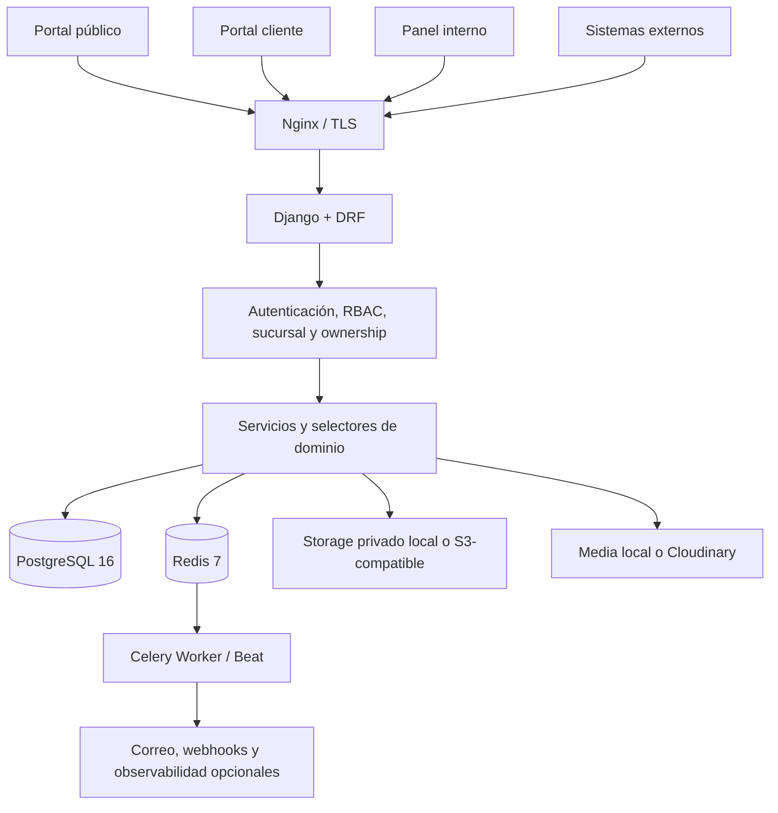

# VINOVA PRO

Plataforma empresarial para administrar la operación comercial y operativa de
una empresa automotriz con múltiples sucursales. VINOVA PRO integra portal
público, portal cliente, CRM, vehículos, inventario, ventas, facturación
interna, documentos, analítica, privacidad, auditoría e integraciones sobre una
arquitectura Django modular.

> **Estado:** candidato apto para beta controlada según las pruebas históricas
> registradas en el proyecto. No está declarado `PRODUCTION READY`; staging, TLS, proveedores,
> restauración real, revisión jurídica y beta humana siguen siendo gates
> externos.

## Identidad del repositorio

| Elemento | Valor |
|---|---|
| Producto | VINOVA PRO `2.0.0` |
| Modelo operativo | Monocompañía con alcance por sucursal |
| Repositorio | Distribución comercial independiente |
| Rama principal | `main` |
| Remoto | [`Tokyogh/vinova-concesionarias`](https://github.com/Tokyogh/vinova-concesionarias) |
| Historial | Distribución comercial independiente |
| Estado funcional | Implementado y probado localmente; beta humana pendiente |

Esta distribución contiene el código y la documentación de VINOVA PRO, pero no
incluye el historial Git del proyecto de desarrollo, archivos de entorno,
datos privados, evidencia local ni la referencia fuente de VINOVA LITE. El
producto conserva los flujos válidos de LITE mediante la arquitectura, los
modelos y los controles empresariales propios de PRO.

## Estado verificable

Inventario del runtime preparado para publicación al 20 de octubre de 2026:

| Métrica | Resultado |
|---|---:|
| Apps de producto | 27 |
| Modelos propios cargados por Django | 87 |
| Patrones URL resueltos | 1.329 |
| Roles canónicos | 13 |
| Permisos sembrados | 64 |
| Migraciones numeradas | 64 |

Los documentos anteriores a F17 pueden conservar cifras menores. El inventario
de esta página fue recalculado contra el runtime actual; no representa una
certificación externa.

## Capacidades principales

| Dominio | Capacidades implementadas | Condición o límite |
|---|---|---|
| Cuentas | Login por usuario/correo, recuperación, perfil, avatar, sesiones y 2FA/TOTP | 2FA no se fuerza globalmente por defecto |
| Empresa y sucursales | Perfil, branding, datos de contacto, sedes, horarios, servicios, foto, website, coordenadas y publicación | Multimedia y mapas dependen del storage/proveedor configurado |
| RBAC | Roles múltiples, permisos por código, alcance global o por sucursal, vigencia y revocación | El acceso efectivo combina cuenta, rol, permiso, vigencia y scope |
| Clientes y portal | Expediente, ownership, perfil, preferencias, garaje, documentos, facturas y notificaciones | Los recursos privados se filtran por `Customer.account` |
| Vehículos | Marcas/modelos, CRUD, publicación, galería, recursos, especificaciones, favoritos y códigos de vinculación | Identificadores sensibles requieren controles reforzados |
| Inventario | Categorías, artículos, stock por sede, mínimos, movimientos, transferencias y catálogo público acotado | El catálogo público no expone costos, cantidades ni movimientos |
| CRM | Captación limitada, pipeline, asignación, actividades, test drive, conversión y exportación | Formularios públicos mantienen rate limiting y validación backend |
| Ventas | Cotizaciones, reservas, ventas, líneas, pagos, estados, anulaciones y aprobaciones | Las reglas financieras ambiguas requieren decisión empresarial |
| Facturación | Comprobantes internos, secuencias, líneas, emisión, pagos, anulaciones, PDF y portal | No constituye integración fiscal operativa con el SRI |
| Postventa | Órdenes, líneas, estados e historial | Módulo opcional, `OFF` por defecto |
| Documentos | Biblioteca, categorías, documentos privados, manuales, lifecycle y descargas auditadas | Antivirus/CDR externo continúa pendiente |
| Notificaciones | Bandeja, destinatarios, plantillas, preferencias y campañas | Correo real debe validarse con el proveedor elegido |
| Importaciones | CSV/XLSX, plantillas, prevalidación, revalidación y confirmación | No autoriza importaciones históricas de LITE |
| Reportes y BI | Reportes operativos, exportaciones y datasets comerciales versionados | Los datasets de clientes/leads omiten datos personales directos |
| Privacidad | Consentimiento granular, solicitudes, exportación, retención y anonimización | Textos legales son borradores pendientes de revisión jurídica |
| Auditoría | Eventos, redacción, filtros, exportación, alertas e integridad encadenada | Un sink externo e inmutable sigue recomendado |
| API e integraciones | OpenAPI, clientes técnicos, scopes, idempotencia, webhooks HMAC y logs | Proveedores, TLS y egreso deben validarse en infraestructura candidata |
| Continuidad y QA | Backups, verificación, restore drills, runner aislado y perfiles `quick/full/release` | Restore y capacidad reales siguen siendo gates externos |
| Ayuda | Artículos, checklists, contexto por ruta, publicación y versionado | La gestión requiere `help.manage`; `is_staff` no basta |

El inventario ampliado está en [`docs/FUNCIONALIDADES.md`](docs/FUNCIONALIDADES.md).

## Arquitectura

VINOVA PRO es un monolito modular Django. Las fronteras de dominio viven en
`apps/`; la seguridad no depende de ocultar botones ni de confiar en IDs
proporcionados por el cliente.



Flujo interno recomendado:

```text
URL / API / tarea
  → middleware y feature flags
  → autenticación + permiso + vigencia + sucursal/ownership
  → formulario o serializer
  → selector / servicio transaccional
  → modelos, constraints y persistencia
  → auditoría y efectos secundarios acotados
```

Responsabilidades por capa:

- `views.py` y `api/views.py`: frontera HTTP, método, autenticación y permiso;
- `forms.py` y serializers: tipos, formatos, relaciones y choices autorizadas;
- `selectors.py`: lecturas filtradas por sucursal, ownership y estado;
- `services.py`: mutaciones, transacciones, locks, idempotencia y auditoría;
- `models.py`: relaciones, constraints y estado persistente;
- `tasks.py`: trabajo asíncrono idempotente y acotado.

Detalles: [arquitectura](docs/ARQUITECTURA.md) y
[base de datos](docs/BASE_DATOS.md).

## Flujos funcionales

### Comercial

```text
Catálogo público → Lead → Actividad/Test drive → Cliente
                 → Cotización/Reserva → Venta → Pago/Factura interna
                 → Documento/Notificación → Analítica
```

### Vinculación de vehículos

El personal autorizado emite un código protegido y temporal. El cliente lo
canjea desde su portal; el servicio valida formato, vigencia, unicidad,
ownership e idempotencia antes de vincular el vehículo. El canje no solicita ni
inventa kilometraje.

### Inventario

Las existencias pertenecen a una sucursal. Entradas, salidas, ajustes y
transferencias se ejecutan mediante servicios; los catálogos públicos usan una
proyección separada y cualitativa.

### Ayuda administrable

Los artículos pueden crearse, previsualizarse, publicarse, despublicarse y
restaurarse desde versiones inmutables. La visibilidad se filtra por estado,
categoría, rol, permiso y ruta contextual.

## Roles, sucursales y ownership

Los roles base son: `superadmin`, `admin_general`, `admin_sucursal`,
`gerente_comercial`, `jefe_inventario`, `vendedor`, `asesor_postventa`,
`facturacion`, `bodega`, `marketing`, `soporte_cliente`, `auditor` y `cliente`.

Una asignación puede ser global o pertenecer a una sucursal, y puede tener
inicio, vencimiento o revocación. `superadmin` como rol de negocio no equivale
automáticamente a `is_superuser` de Django. Los recursos del portal cliente
añaden ownership a través de su expediente.

Fuente y matriz: [roles y permisos](docs/ROLES_PERMISOS.md) y
[matriz RBAC](docs/auditoria-integral/04-matriz-rbac.md).

## API e integraciones

- contrato recomendado: `/api/v1/`;
- OpenAPI: `/api/v1/schema/`;
- Swagger UI: `/api/v1/docs/`;
- sesión Django para operación interna;
- Bearer tokens de un solo secreto visible para usuarios de servicio;
- scopes API, permisos funcionales, sucursal, vigencia, allowlist IP y rate limit;
- idempotencia para entradas de integración;
- webhooks firmados con HMAC-SHA256, reintentos y logs;
- datasets BI JSON/CSV sin datos personales directos de clientes o leads.

Los tokens técnicos nunca reemplazan los permisos de negocio. En producción,
la documentación API debe permanecer restringida salvo decisión explícita.

Contrato completo: [`docs/API.md`](docs/API.md).

## Seguridad y privacidad

Controles implementados y cubiertos localmente:

- CSRF, autoescape y CSP con nonce;
- cookies productivas `__Host-`, `Secure`, `HttpOnly` y `SameSite` según uso;
- rotación/revocación de sesiones, política de contraseñas y 2FA;
- RBAC, mínimo privilegio, alcance por sucursal y ownership;
- rate limiting y protección de formularios públicos;
- validación contextual de texto, identificadores, importes, fechas y archivos;
- límites para ZIP/Office, CSV/XLSX y archivos de continuidad;
- descargas privadas autorizadas y auditadas;
- protección SSRF para webhooks mediante resolución y destino fijados;
- redacción de logs y auditoría encadenada;
- consentimiento previo para preferencias, analítica y contenido externo;
- acceso Staff adaptativo `off|monitor|enforce`, entregado en `off`.

La referencia de control es OWASP ASVS 5.0 con objetivo L2, complementada por
CIA/STRIDE, OWASP Top 10/API Security, NIST SSDF y OWASP SAMM. Esto expresa el
modelo de trabajo, no una certificación ni una garantía de seguridad absoluta.

Consulte la [guía de seguridad](docs/SECURITY.md), el
[modelo de amenazas](docs/seguridad-avanzada/03-modelo-amenazas.md) y la
[matriz ASVS](docs/seguridad-avanzada/04-matriz-asvs.md).

## Tecnologías verificadas

| Capa | Tecnología |
|---|---|
| Runtime | Python 3.12, Django 5.2 |
| API | Django REST Framework 3.17.2, django-filter, drf-spectacular |
| Datos | PostgreSQL 16; SQLite solo para pruebas rápidas |
| Cache y colas | Redis 7, Celery 5 |
| Web | Gunicorn, Nginx, templates Django y HTMX 2.0.10 local |
| Archivos | Storage privado local o S3-compatible; media local o Cloudinary |
| Mapas | MapLibre/MapTiler opcionales y condicionados al consentimiento |
| QA | Pytest, pytest-django, Playwright, Ruff y runner propio |
| Operación | Docker Compose, healthchecks, backups, smoke y rollback documentado |

Las dependencias productivas se fijan con hashes en
`requirements/production.lock`; las imágenes externas se referencian por
digest. Las integraciones opcionales no se consideran verificadas contra
proveedores reales hasta ejecutar sus gates.

## Estructura del proyecto

```text
apps/          dominios Django, APIs, migraciones y pruebas
config/        settings por entorno, URLs, WSGI/ASGI y Celery
deployment/    contratos y automatización de despliegue
docker/        entrypoint, Nginx y runtime QA
docs/          documentación técnica, manuales y evidencia
requirements/ rangos de dependencias y lock productivo
scripts/       QA, seguridad, backups, release y operación
static/        CSS, JavaScript, imágenes y HTMX versionado
templates/     portal público, cliente y panel interno
tests/         regresiones transversales, seguridad y E2E
```

## Puesta en marcha local

Requisitos: Docker Desktop con WSL2 en Windows, o Docker Engine con Compose.
Los puertos de desarrollo predeterminados son 8000, 5432, 6379, 8025 y 1025.

```bash
cp .env.example .env
# Configure secretos locales únicos antes de usar datos reales.
docker compose build
docker compose run --rm web python manage.py migrate
docker compose run --rm web python manage.py seed_roles
docker compose run --rm web python manage.py seed_api_scopes
docker compose run --rm web python manage.py seed_help_center
docker compose run --rm web python manage.py createsuperuser
docker compose up -d --remove-orphans
docker compose ps
```

Accesos locales:

| Servicio | URL |
|---|---|
| Aplicación | `http://localhost:8000` |
| Swagger v1 | `http://localhost:8000/api/v1/docs/` |
| Mailpit | `http://localhost:8025` |

No ejecute comandos `seed_demo_*` sobre datos reales sin autorización.
Instrucciones completas: [instalación](docs/INSTALACION.md).

## Configuración

Use `.env.example`, `.env.staging.example` o `.env.production.example` como
contratos sin valores reales. Los `.env` efectivos nunca se versionan.

Áreas principales:

- identidad, hosts, CSRF, proxy y HTTPS;
- PostgreSQL, Redis y Celery;
- correo, Sentry y niveles de log;
- storage público/privado;
- clientes API, webhooks e idempotencia;
- límites de uploads, ZIP, importaciones y archivos;
- consentimiento, mapas y catálogo público de repuestos;
- postventa, QA y backups mediante flags desactivados por defecto cuando aplica.

`SECRET_KEY` y `VINOVA_API_TOKEN_PEPPER` deben ser secretos distintos. La
política Staff se administra y audita dentro de la aplicación; no debe activarse
en `enforce` sin red confiable, 2FA, aprobadores y recuperación probados.

Referencia: [`docs/CONFIGURACION.md`](docs/CONFIGURACION.md).

## Testing y evidencia

Suite local aislada:

```powershell
$env:DJANGO_SETTINGS_MODULE='config.settings.test'
$env:VINOVA_QA_IGNORE_PROJECT_ENV='1'
python manage.py check
python manage.py makemigrations --check --dry-run
python -m ruff check .
python scripts/audit_bilingual_documentation.py --strict
python -m pytest -q
```

Perfiles empresariales:

```powershell
.\scripts\vinova-qa.ps1 quick
.\scripts\vinova-qa.ps1 full
.\scripts\vinova-qa.ps1 release
```

| Evidencia | Resultado documentado | Alcance |
|---|---|---|
| 17-oct-2026 | 2.602 pruebas Python aprobadas; 33 E2E Chromium aprobadas | Seguridad y consolidación local |
| 19-oct-2026 | 2.669 pruebas PostgreSQL aprobadas; 34 E2E Chromium aprobadas | Correcciones funcionales e integridad |
| Focal histórica | 2.079 pruebas de seguridad/RBAC/ownership aprobadas | Una omisión negativa intencional |
| Beta manual | 248 casos preparados | Pendientes de ejecución humana |

Estos resultados son históricos y están vinculados a los candidatos descritos
en cada informe; no sustituyen una nueva ejecución sobre otro commit.

- [Testing](docs/TESTING.md)
- [Mapas funcionales](docs/mapas-funcionales/README.md)
- [Guías beta](docs/testeo-beta/testeo-indice-maestro.md)

## Despliegue y continuidad

En producción, Nginx es el único servicio público. Django, PostgreSQL, Redis,
Celery Worker y Celery Beat permanecen en redes internas. `app_init` ejecuta
checks, migraciones y `collectstatic` una vez; los documentos privados no se
montan en Nginx.

Antes de desplegar se exige, como mínimo:

1. backup verificado y plan de rollback;
2. checks, migraciones y pruebas sobre el candidato;
3. SBOM y escaneo de dependencias/imágenes;
4. TLS, proxy, headers y DNS reales;
5. smoke de aplicación, worker, storage y proveedores;
6. restore medido sobre infraestructura candidata.

No use `docker compose down -v` durante una actualización normal.

- [Producción](docs/PRODUCCION.md)
- [Backups](docs/BACKUPS.md)
- [Recuperación](docs/EMERGENCY_RECOVERY.md)
- [Operación](docs/OPERACION.md)

## Límites y pendientes

- No es SaaS ni multi-tenant.
- No existe integración fiscal SRI operativa; la base heredada no equivale a
  emisión o certificación tributaria.
- No incluye recordatorios automáticos de mantenimiento.
- No autoriza migraciones históricas desde LITE.
- No crea datos demostrativos persistentes automáticamente.
- Postventa está deshabilitada por defecto.
- Antivirus/CDR, egreso de red, vault/HSM y auditoría externa inmutable siguen
  como mejoras de infraestructura.
- Staging, DNS/TLS, proveedores reales, restore, capacidad, revisión legal,
  revisión visual y beta humana siguen pendientes.

## Preparación segura de esta distribución

- la copia no contiene el historial Git del proyecto de desarrollo;
- `.env`, datos privados, logs, media, backups, reportes locales y cachés están
  excluidos por `.gitignore`;
- `nd.txt` y la referencia `web_carros/` no forman parte de esta distribución;
- Gitleaks 8.30.1 reportó cero hallazgos sobre el árbol preparado el
  19 de octubre de 2026;
- los resultados de escaneo deben repetirse sobre cada candidato antes de
  publicarlo.

## Documentación

El índice canónico está en [`docs/README.md`](docs/README.md). Puntos de entrada:

- [estado actual](docs/ESTADO_ACTUAL.md);
- [arquitectura](docs/ARQUITECTURA.md);
- [funcionalidades](docs/FUNCIONALIDADES.md);
- [API](docs/API.md);
- [seguridad](docs/SECURITY.md);
- [manuales](docs/manuals/README.md);
- [paridad LITE → PRO](docs/PARIDAD_LITE_PRO.md);
- [modelo de amenazas](docs/seguridad-avanzada/03-modelo-amenazas.md);
- [matriz OWASP ASVS](docs/seguridad-avanzada/04-matriz-asvs.md).

## Licenciamiento

El código propio está sujeto al [`LICENSE`](LICENSE) propietario preliminar.
La presencia del código fuente en este repositorio no concede por sí sola
derechos de uso, instalación, modificación, comercialización o redistribución.
El alcance comercial, la duración, las copias autorizadas, el soporte y las
actualizaciones deben constar en un acuerdo escrito con el titular.

Los componentes de terceros conservan sus propias licencias. Consulte
[`THIRD_PARTY_NOTICES.md`](THIRD_PARTY_NOTICES.md) y los avisos incluidos junto
a cada componente. El texto de licenciamiento requiere revisión jurídica antes
de utilizarse como contrato comercial definitivo.

## Publicación y uso

- `main` es la rama principal de esta distribución.
- No publique archivos de entorno, credenciales, certificados, media, storage
  privado, backups, dumps, logs ni evidencia con datos reales.
- Ejecute checks, pruebas proporcionales, revisión del índice y escaneo de
  secretos antes de cada push.
- No use force push ni reescriba historial para ocultar hallazgos.
